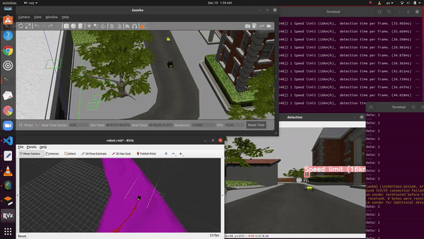
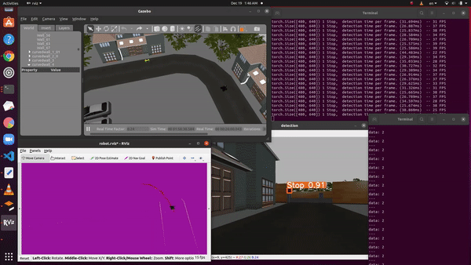
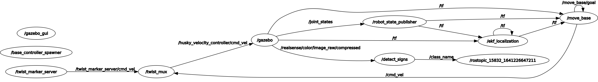

# ROS Husky Traffic Sign Detection

Legacy ROS/catkin demo for traffic-sign detection from a Husky/Gazebo camera stream.

The repository wraps a YOLOv5-style detector inside a ROS node, subscribes to a compressed camera image topic, publishes annotated images, and publishes the detected traffic-sign class ID for downstream planner logic.

## Project Snapshot

| Aspect | Summary |
|---|---|
| Main role | ROS 1 perception demo for Husky/Gazebo traffic-sign detection. |
| ROS stack | Catkin workspace style, using `rospy`, `sensor_msgs`, `std_msgs`, `nav_msgs`, and `cv_bridge`. |
| Perception layer | YOLOv5-derived detection code in `src/yolo_bot/`. |
| Output | Annotated image stream and detected sign class on `/class_name`. |
| Portfolio role | Legacy perception and Gazebo evidence; not the main ROS2 lab repo. |

## Demo Media

| Speed-limit detection | Stop-sign detection |
|---|---|
|  |  |

ROS graph from the original integration:



## What This Demonstrates

- ROS image subscription from a simulated camera stream.
- OpenCV/CvBridge conversion from compressed ROS images to detector input.
- YOLO-style traffic-sign detection on incoming frames.
- Publishing annotated detections to `/camera/image_output/compressed`.
- Publishing detected class IDs to `/class_name`.
- Integration context with Husky navigation and Gazebo simulation commands.

## What This Is Not

- Not a complete autonomous-driving stack.
- Not a ROS2 package.
- Not a planner, controller, or full navigation system.
- Not a benchmarked traffic-sign dataset release.
- Not a claim of production-level perception robustness.

## Repository Structure

```text
assets/                         demo GIFs and ROS graph
detect_streams_signs.sh          convenience command for detector launch
requirements.txt                 Python detector dependency pointer
src/
  CMakeLists.txt                 catkin workspace source entry
  yolo_bot/
    package.xml                  ROS package metadata
    CMakeLists.txt               catkin package configuration
    detect_stream_signs.py       ROS stream detector node
    detect_signs.py              earlier detector integration draft
    detect.py                    YOLO detection entry point
    models/                      YOLO model definitions
    utils/                       YOLO utility code
    requirements.txt             detector Python dependencies
```

Generated `build/`, `devel/`, and Python cache files are intentionally not tracked.

## Expected Topics

The active detector node uses:

| Topic | Direction | Message type | Role |
|---|---|---|---|
| `/realsense/color/image_raw/compressed` | Subscribe | `sensor_msgs/CompressedImage` | Camera input from simulation/sensor stream. |
| `/camera/image_output/compressed` | Publish | `sensor_msgs/CompressedImage` | Annotated detection image. |
| `/class_name` | Publish | `std_msgs/Int16` | Detected traffic-sign class ID. |

The earlier draft uses `/camera/rgb/image_raw/compressed`; topic names may need adjustment for a different Gazebo setup.

## Installation

Use a ROS 1/catkin environment with Python 3 support, such as a ROS Noetic-style setup.

```bash
mkdir -p ~/catkin_ws/src
cd ~/catkin_ws/src
git clone https://github.com/WikiGenius/ros-husky-traffic-sign-detection.git
cd ~/catkin_ws
catkin_make
source devel/setup.bash
```

Install the detector-side Python dependencies:

```bash
python3 -m pip install -r src/ros-husky-traffic-sign-detection/requirements.txt
```

ROS dependencies such as `rospy`, `cv_bridge`, `sensor_msgs`, `std_msgs`, and `nav_msgs` should come from the ROS installation, not from `pip`.

## Run

Start the required simulation/navigation stack separately. The original project used commands like:

```bash
roslaunch darknet_ros world.launch
roslaunch darknet_ros robot.launch
roslaunch husky_viz view_robot.launch
roslaunch husky_navigation move_base_mapless_demo.launch
```

Then run the detector command:

```bash
./detect_streams_signs.sh
```

Monitor the detected class topic:

```bash
rostopic echo /class_name
```

## Weights And Data

The detector command expects trained YOLO weights under:

```text
src/yolo_bot/runs/train/yolov5s_results/weights/best.pt
```

Weights, datasets, generated runs, and local videos are not committed to this repository. Add them locally when reproducing the original workflow.

## Relation To The ROS Portfolio

| Repo | Role |
|---|---|
| [`ros2-mobile-robotics-labs`](https://github.com/WikiGenius/ros2-mobile-robotics-labs) | Main ROS2 learning and mobile robotics organization hub. |
| [`hello_world_ros2_edx`](https://github.com/WikiGenius/hello_world_ros2_edx) | ROS2 learning/migration evidence from course material. |
| [`husky-gazebo-image-capture`](https://github.com/WikiGenius/husky-gazebo-image-capture) | ROS2 Husky image and odometry capture for visual-SLAM datasets. |
| [`ros2-moveit-grasping-demo`](https://github.com/WikiGenius/ros2-moveit-grasping-demo) | ROS2/MoveIt2 manipulation and perception-guided grasping evidence. |

This repository stays separate because it is a legacy ROS/catkin perception demo, while `ros2-mobile-robotics-labs` should remain the clean ROS2 organization layer.

## Limitations

- Legacy ROS/catkin structure.
- Requires an external Gazebo/Husky/navigation setup.
- Topic names are hard-coded in the detector node.
- The planner that consumes `/class_name` is not included here.
- Trained weights and datasets are not included.
- No quantitative detection metrics are reported.

## Roadmap

- [ ] Parameterize topic names and model path.
- [ ] Add a minimal launch file if the full simulation setup is made public-safe.
- [ ] Document the expected class-ID mapping.
- [ ] Add one small public-safe test image or replay workflow.
- [ ] Keep ROS2 mobile robotics work in the ROS2 lab family rather than mixing stacks.

## Citation / Acknowledgment

This project uses ROS, Gazebo/Husky tooling, OpenCV/CvBridge, and YOLOv5-derived detection code. The YOLO-derived source under `src/yolo_bot/` keeps its upstream GPL license file.
